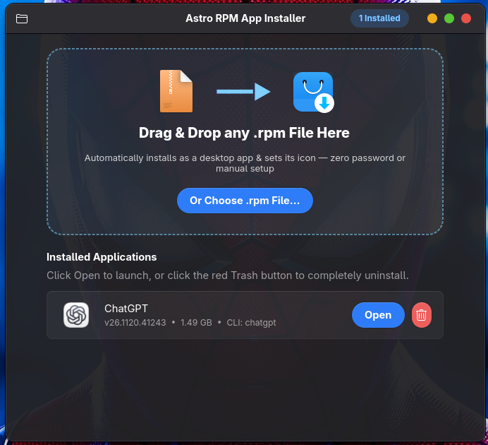
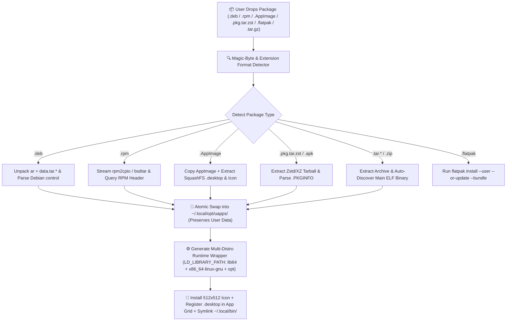
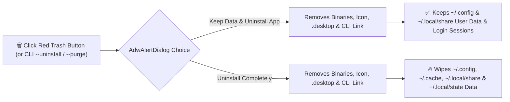

<div align="center">


# Universal Linux App Installer (`uapp`)

**Install `.deb`, `.rpm`, `.AppImage`, `.pkg.tar.zst`, `.apk`, `.flatpak`, and `.tar.gz` on ANY Linux Distro via macOS-Style Drag & Drop**  
*Built in 100% Native C with GTK4 & Libadwaita — Zero Python, Zero Root Prompts, Instant Startup*

[](LICENSE)
[](src/main.c)
[](src/main.c)
[](https://github.com/cyberhavik/universal-linux-app-installer/releases)
[](https://github.com/cyberhavik/universal-linux-app-installer/releases/latest)

<br />



</div>

---

## ✨ Overview

**Universal Linux App Installer (`uapp`)** eliminates Linux package fragmentation by allowing you to **drag and drop any Linux application package onto a single macOS-style window on ANY Linux distribution**.

Ever wanted to install an **Ubuntu `.deb` package on Fedora or Arch Linux**? Or install a **Fedora `.rpm` package on Ubuntu/Debian**? Or automatically integrate a downloaded **`.AppImage` or `.tar.gz` tarball** into your GNOME/KDE Application Grid with its proper icon and CLI launcher without writing `.desktop` files by hand?

`uapp` inspects the file's magic bytes and format, extracts and sandboxes the application payload into user space (`~/.local/opt/uapps/<app_id>`), automatically configures cross-distro shared library paths (`usr/lib64`, `usr/lib/x86_64-linux-gnu`, `opt/<app>`), extracts high-resolution icons, creates a `.desktop` launcher in your Application Grid, and links the CLI binary into `~/.local/bin/` — **all with zero `sudo` password prompts and zero system package conflicts.**

---

## 🌐 Universal Multi-Format Support Matrix

| Package Format | Native Distros | Works on Other Distros? | How `uapp` Installs It Universally (Rootless) |
| :--- | :--- | :---: | :--- |
| **`.deb`** | Ubuntu, Debian, Linux Mint, Pop!_OS, Kali | ✅ **Yes** (Fedora, Arch, etc.) | Unpacks outer `ar` archive + `data.tar.zst`/`.xz`/`.gz` & `control.tar.*` without needing `dpkg` or `apt`, parses `control` metadata, and maps multiarch `lib/x86_64-linux-gnu` paths. |
| **`.rpm`** | Fedora, RHEL, CentOS, openSUSE, Nobara | ✅ **Yes** (Ubuntu, Arch, etc.) | Streams payload via `rpm2cpio \| cpio` (with automatic `bsdtar` / `7z` fallback on Debian/Arch), reads RPM header tags, and maps `usr/lib64`. |
| **`.AppImage`** | Universal Linux (Type 2 AppImage) | ✅ **Yes** (All Distros) | Moves `.AppImage` to `~/.local/opt/uapps/`, extracts internal SquashFS `.desktop` and `.png`/`.svg` icon via `unsquashfs` / `--appimage-extract`, and registers it in your app grid. |
| **`.pkg.tar.zst` / `.xz`** | Arch Linux, Manjaro, EndeavourOS, CachyOS | ✅ **Yes** (Fedora, Ubuntu, etc.) | Extracts Zstandard/XZ tar payload, parses `.PKGINFO` (`pkgname`, `pkgver`, `pkgdesc`), and generates desktop + CLI launchers. |
| **`.apk`** | Alpine Linux, Chimera Linux | ✅ **Yes** (All Distros) | Extracts gzipped tar payload, reads `.PKGINFO`, and wires up user-space runtime paths. |
| **`.flatpak`** | Universal Flatpak Single-File Bundle | ✅ **Yes** (All Distros) | Installs single-file `.flatpak` bundles directly into `--user` installation (`flatpak install --user -y --or-update --bundle`). |
| **`.tar.gz` / `.tar.xz` / `.zip`** | Portable Linux App Releases | ✅ **Yes** (All Distros) | Automatically discovers the main ELF binary and icon inside portable archives and creates a desktop entry + CLI symlink. |

---

## 🚀 Key Features

- 🍏 **macOS-Style Drag & Drop GUI** — Drop any `.deb`, `.rpm`, `.AppImage`, `.pkg.tar.zst`, `.apk`, `.flatpak`, or `.tar.gz` directly onto the window.
- ⚡ **100% Native C (GTK4 + Libadwaita)** — Compiled ~65 KB native ELF binary. Zero Python, zero Electron bloat, `<15ms` cold start, and non-blocking `GTask` asynchronous worker threads.
- 🔒 **Zero Root / Zero Password Prompts** — Installs applications cleanly inside `~/.local/opt/uapps/`, keeping your base OS (including Fedora Silverblue / SteamOS / immutable distros) 100% untouched.
- 🔄 **Atomic In-Place Updates (Zero Data Loss)** — Dropping a newer version of an installed package atomically swaps the application binaries via a staging directory while preserving 100% of your login sessions, settings, and user data.
- 🗑️ **Dual-Mode Uninstaller (`Keep Data` vs. `Uninstall Completely`)** — Clicking the red Trash button opens a native Libadwaita dialog allowing you to choose:
  1. **Keep Data & Uninstall App** — Removes the application, icon, and launcher while preserving `~/.config` and `~/.local/share` user settings.
  2. **Uninstall Completely (Delete All Data)** — Removes the application **and** completely purges all associated user data, login sessions, and caches across `~/.config`, `~/.cache`, `~/.local/share`, and `~/.local/state`.

---

## 🧭 System Architecture & Workflow Diagrams

### 1. Universal Multi-Format Drag & Drop Installation Pipeline



### 2. Dual-Mode Uninstaller Flow (`Keep Data` vs. `Complete Purge`)



---

## 📦 Installation

### Option 1: Install from Prebuilt Release `.rpm` or Binary

Download the latest release from the [**Releases**](https://github.com/cyberhavik/universal-linux-app-installer/releases/latest) page:

```bash
# On Fedora / RHEL / openSUSE:
sudo dnf install ./universal-app-installer-1.0.0-1.*.x86_64.rpm

# Or install the prebuilt universal binary on ANY Linux distro (Ubuntu, Arch, Fedora, Debian) without root:
chmod +x uapp-linux-x86_64
mkdir -p ~/.local/bin
mv uapp-linux-x86_64 ~/.local/bin/uapp
```

### Option 2: Build from Source (Any Linux Distro)

#### Prerequisites
- **Fedora / RHEL**: `sudo dnf install gcc make pkg-config gtk4-devel libadwaita-devel rpm cpio binutils tar zstd unzip squashfs-tools`
- **Ubuntu / Debian**: `sudo apt install gcc make pkg-config libgtk-4-dev libadwaita-1-dev rpm2cpio cpio binutils tar zstd unzip squashfs-tools`
- **Arch Linux**: `sudo pacman -S gcc make pkgconf gtk4 libadwaita rpm-tools cpio binutils tar zstd unzip squashfs-tools`

#### Compile & Install
```bash
git clone https://github.com/cyberhavik/universal-linux-app-installer.git
cd universal-linux-app-installer
make
make install-user
```

---

## 🖥️ Usage

### Graphical Interface (Drag & Drop)

Launch **Universal Linux App Installer** from your desktop Applications menu, or run:

```bash
uapp
```

### Command-Line Interface (CLI)

```text
╭──────────────────────────────────────────────────────────────────────╮
│  uapp — Universal Linux Drag & Drop App Installer (Native C / GTK4)  │
╰──────────────────────────────────────────────────────────────────────╯
  Supported Formats on ANY Linux Distro:
    • .deb          (Ubuntu, Debian, Mint, Pop!_OS — works even on Fedora/Arch!)
    • .rpm          (Fedora, RHEL, openSUSE — works even on Ubuntu/Arch!)
    • .AppImage     (Universal AppImage with desktop launcher & icon extraction)
    • .pkg.tar.zst  (Arch Linux, Manjaro, CachyOS packages)
    • .apk          (Alpine / Chimera Linux packages)
    • .flatpak      (Single-file Flatpak bundles)
    • .tar.* / .zip (Portable Linux application tarballs & archives)

  Usage:
    uapp                              Launch Universal Drag & Drop GUI
    uapp <package_file>               Open GUI and auto-install package
    uapp --cli <package_file>         Install package silently in terminal
    uapp --list                       List all installed applications
    uapp --uninstall <app_id>         Uninstall app (keep user data & login)
    uapp --purge <app_id>             Uninstall completely (delete all user data)
    uapp -h, --h, --help              Show this help message
```

#### CLI Examples
```bash
# Install an Ubuntu .deb package on Fedora or Arch
uapp --cli ~/Downloads/discord_0.0.75_amd64.deb

# Install a Fedora .rpm package on any distro
uapp --cli ~/Downloads/chatgpt.x86_64.rpm

# Install an .AppImage and automatically create its desktop icon
uapp --cli ~/Downloads/Obsidian-1.7.7.AppImage

# Install an Arch Linux .pkg.tar.zst package
uapp --cli ~/Downloads/app-1.0.0-1-x86_64.pkg.tar.zst

# List all installed applications across all formats
uapp --list

# Uninstall an app while keeping its ~/.config & ~/.local/share user data
uapp --uninstall chatgpt

# Completely uninstall an app and wipe all user data & caches
uapp --purge chatgpt
```

---

## 📄 License

Distributed under the **MIT License**. See [`LICENSE`](LICENSE) for full details.

---

<div align="center">
  <sub>Crafted with ❤️ in Native C by <a href="https://github.com/cyberhavik">Saurav Kumar (@cyberhavik)</a></sub>
</div>
